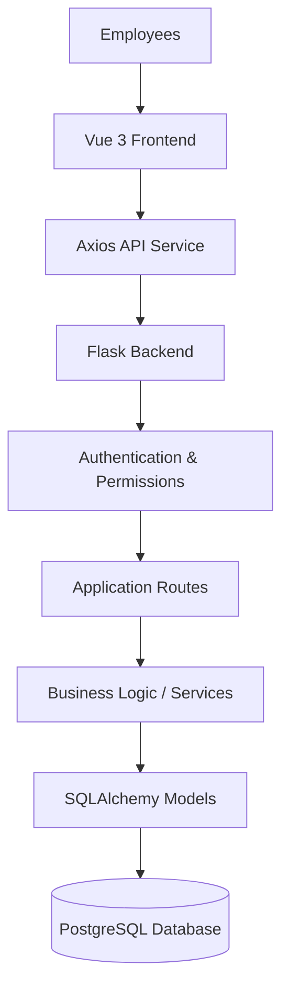
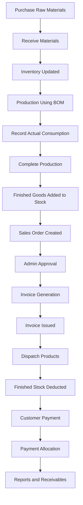
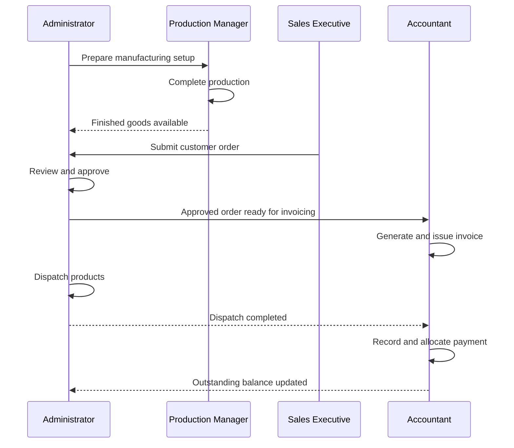

# SnackFlow ERP

### Manufacturing Management System

**SnackFlow ERP** is a web-based Enterprise Resource Planning system designed for small and medium-sized snack manufacturing businesses.

It brings inventory, procurement, production, sales, invoicing, dispatch and payments together in one centralized platform.

The goal is simple: manage the complete journey from raw materials to finished products and customer payments.

---

## 1. About the Project

SnackFlow addresses common challenges faced by small manufacturing businesses:

- Disconnected records across different departments.
- Difficulty tracking raw materials and finished goods.
- Manual production and material consumption tracking.
- Complicated sales order and invoice management.
- Difficulty monitoring customer payments and outstanding balances.

SnackFlow connects these operations through a single application with role-based access.

### Key Features

| Module                | Functionality                                |
| --------------------- | -------------------------------------------- |
| Dashboard             | Role-specific business overview              |
| Items                 | Manage products and materials                |
| Customers & Suppliers | Maintain business records                    |
| Inventory             | Track stock and movements                    |
| Purchases             | Record and receive materials                 |
| Production            | Manage BOM-based manufacturing               |
| Sales Orders          | Create and approve customer orders           |
| Invoices              | Generate and issue invoices                  |
| Dispatches            | Manage product deliveries                    |
| Payments              | Record and allocate customer payments        |
| Reports               | Inventory, sales, production and receivables |
| Employees             | Manage employee accounts and access          |

---

## 2. Technology Stack

| Layer               | Technologies                   |
| ------------------- | ------------------------------ |
| Frontend            | Vue 3, JavaScript, Bootstrap 5 |
| Build Tool          | Vite                           |
| Backend             | Python, Flask                  |
| Database            | PostgreSQL                     |
| ORM                 | Flask-SQLAlchemy               |
| Authentication      | Flask-JWT-Extended             |
| Database Migrations | Flask-Migrate                  |
| API Communication   | Axios                          |
| PDF Generation      | ReportLab                      |

---

## 3. System Architecture

SnackFlow follows a frontend-backend architecture.



- **Frontend:** Displays the application and handles user interactions.
- **Backend:** Handles business rules, authentication and data processing.
- **Database:** Stores employee, customer, inventory, production and financial records.

---

## 4. Repository Structure

The repository is divided into two main applications.

```text
SnackFlow-ERP/
│
├── backend/
│   ├── app/
│   │   ├── models/
│   │   ├── routes/
│   │   ├── services/
│   │   ├── utils/
│   │   ├── __init__.py
│   │   └── config.py
│   │
│   ├── migrations/
│   ├── .env
│   ├── requirements.txt
│   └── run.py
│
├── frontend/
│   ├── public/
│   ├── src/
│   │   ├── assets/
│   │   ├── components/
│   │   ├── layouts/
│   │   ├── services/
│   │   ├── views/
│   │   ├── router.js
│   │   ├── App.vue
│   │   └── main.js
│   │
│   ├── .env.development
│   ├── .env.production
│   ├── index.html
│   └── package.json
│
└── README.md
```

### Backend — `backend/`

Contains the Flask application and all server-side functionality.

| Location           | What it contains                                                  |
| ------------------ | ----------------------------------------------------------------- |
| `app/models/`      | Database models and relationships                                 |
| `app/routes/`      | Application request handlers and module operations                |
| `app/services/`    | Business logic such as production, purchases and order processing |
| `app/utils/`       | Shared utilities and permission helpers                           |
| `app/config.py`    | Application configuration                                         |
| `app/__init__.py`  | Flask application initialization                                  |
| `migrations/`      | Database schema migration history                                 |
| `run.py`           | Backend entry point                                               |
| `requirements.txt` | Python dependencies                                               |
| `.env`             | Local environment variables and secrets                           |

### Frontend — `frontend/`

Contains the Vue application and its user interface.

| Location          | What it contains                              |
| ----------------- | --------------------------------------------- |
| `src/views/`      | Individual pages for ERP modules              |
| `src/components/` | Reusable interface components                 |
| `src/layouts/`    | Application layout and navigation             |
| `src/services/`   | Axios configuration and backend communication |
| `src/assets/`     | Frontend assets                               |
| `src/router.js`   | Page navigation and route protection          |
| `src/App.vue`     | Root Vue component                            |
| `src/main.js`     | Frontend entry point                          |
| `public/`         | Static assets such as the SnackFlow logo      |
| `index.html`      | Browser document and page title               |
| `package.json`    | Frontend dependencies and scripts             |

---

## 5. User Roles

SnackFlow supports four employee roles. Each role has access to the modules required for its responsibilities.

### Administrator

<text>**Role: ADMIN**</text>

The administrator manages the overall business and ERP system.

- Manage items, customers and suppliers.
- Manage employee accounts and access.
- Manage purchases and inventory.
- Manage production.
- Review, approve and reject sales orders.
- Manage invoices, dispatches and payments.
- Access business reports and audit logs.

### Sales Executive

<text>**Role: SALESMAN**</text>

Responsible for customer orders.

- View customers.
- Create sales orders.
- Submit orders for approval.
- View and track their own orders.

### Production Manager

<text>**Role: PRODUCTION**</text>

Responsible for manufacturing operations.

- View inventory and stock levels.
- Manage production runs.
- Record actual material consumption.
- Record actual production output.
- Complete production runs.

### Accountant

<text>**Role: ACCOUNTANT**</text>

Responsible for financial operations.

- View and issue invoices.
- Record customer payments.
- Allocate payments to invoices.
- Monitor outstanding balances.
- Access financial and business reports.

### Role Access Overview

| Module       | Admin | Salesman | Production | Accountant |
| ------------ | :---: | :------: | :--------: | :--------: |
| Dashboard    |   ✓   |    ✓     |     ✓      |     ✓      |
| Items        |   ✓   |          |            |            |
| Customers    |   ✓   |    ✓     |            |            |
| Suppliers    |   ✓   |          |            |            |
| Inventory    |   ✓   |          |     ✓      |            |
| Purchases    |   ✓   |          |            |            |
| Production   |   ✓   |          |     ✓      |            |
| Sales Orders |   ✓   |    ✓     |            |            |
| Invoices     |   ✓   |          |            |     ✓      |
| Dispatches   |   ✓   |          |            |            |
| Payments     |   ✓   |          |            |     ✓      |
| Reports      |   ✓   |          |            |     ✓      |
| Employees    |   ✓   |          |            |            |

Access is enforced through backend authorization as well as frontend navigation.

---

## 6. Business Workflow

The central workflow connects all major manufacturing operations.



This ensures that purchasing, manufacturing, sales and accounting records remain connected.

---

## 7. Demo Workflow — Example

The following example demonstrates how all four users collaborate to complete a customer order.

**Scenario:** Sri Lakshmi Stores orders 50 packets of Murukku 200g.

### Step 1 — Administrator

- Configures company information.
- Creates items, customers and suppliers.
- Sets up employee accounts.
- Configures the product's Bill of Materials.

### Step 2 — Production Manager

- Checks raw material availability.
- Manages a production run.
- Records actual consumption and output.
- Completes production.
- Finished goods are added to inventory automatically.

### Step 3 — Sales Executive

- Logs in to the Salesman account.
- Selects Sri Lakshmi Stores.
- Creates an order for 50 Murukku packets at ₹50 each.
- Submits the order for approval.

<text color="secondary" size="xs">Example order value</text>

| Description |     Amount |
| ----------- | ---------: |
| 50 × ₹50    |     ₹2,500 |
| GST (5%)    |       ₹125 |
| **Total**   | **₹2,625** |

### Step 4 — Administrator

- Reviews the submitted order.
- Checks the customer and order details.
- Approves the order.

### Step 5 — Accountant

- Generates an invoice from the approved order.
- Reviews the invoice.
- Issues the invoice.

### Step 6 — Administrator

- Creates the dispatch.
- Enters delivery information.
- Confirms dispatch.
- Finished goods stock is automatically reduced by 50 packets.

### Step 7 — Accountant

- Records a ₹2,000 payment through UPI.
- Allocates the payment to the invoice.
- Checks the outstanding amount.

<text color="secondary" size="xs">Final invoice position</text>

| Description      | Amount |
| ---------------- | -----: |
| Invoice          | ₹2,625 |
| Payment received | ₹2,000 |
| Outstanding      |   ₹625 |

### Workflow Participants



---

## 8. Running Locally

### Requirements

- Python 3.11+
- PostgreSQL
- Node.js and npm
- Git

### Backend Setup

```bash
git clone <repository-url>
cd SnackFlow-ERP

cd backend
python -m venv venv
```

Activate the environment on Windows:

```powershell
.\venv\Scripts\Activate.ps1
```

Install dependencies:

```bash
pip install -r requirements.txt
```

Configure the backend `.env` file with the database connection and required secrets.

Create the PostgreSQL database and apply the project's database migrations.

Start Flask:

```bash
python run.py
```

### Frontend Setup

Open another terminal:

```bash
cd frontend
npm install
```

Configure `.env.development`:

```env
VITE_API_BASE_URL=http://127.0.0.1:5000/api
```

Start Vue:

```bash
npm run dev
```

Open the local URL displayed by Vite.

---

## 9. Deployment Configuration

The frontend supports separate development and production backend URLs.

Development:

`frontend/.env.development`

```env
VITE_API_BASE_URL=http://127.0.0.1:5000/api
```

Production:

`frontend/.env.production`

```env
VITE_API_BASE_URL=https://YOUR-DEPLOYED-BACKEND-URL/api
```

Before deployment, configure the actual backend URL, database, CORS and production secrets.

---

## 10. Scope and Limitations

SnackFlow currently focuses on the essential operations of a small snack manufacturing business.

Implemented areas include:

- Role-based employee access.
- Inventory and purchase management.
- BOM-based production.
- Sales order approval.
- Invoice generation.
- Dispatch management.
- Payment allocation.
- Business reporting and audit logs.

Advanced features such as payroll, full accounting ledgers, bank reconciliation and complete statutory GST compliance are outside the current project scope.

**Invoice Disclaimer:** Generated invoice PDFs are demonstration documents and are not valid GST tax invoices.

---

## SnackFlow ERP

**One connected workspace. Every stage of manufacturing.**

From raw materials to production, from customer orders to payments — SnackFlow brings business operations together.
