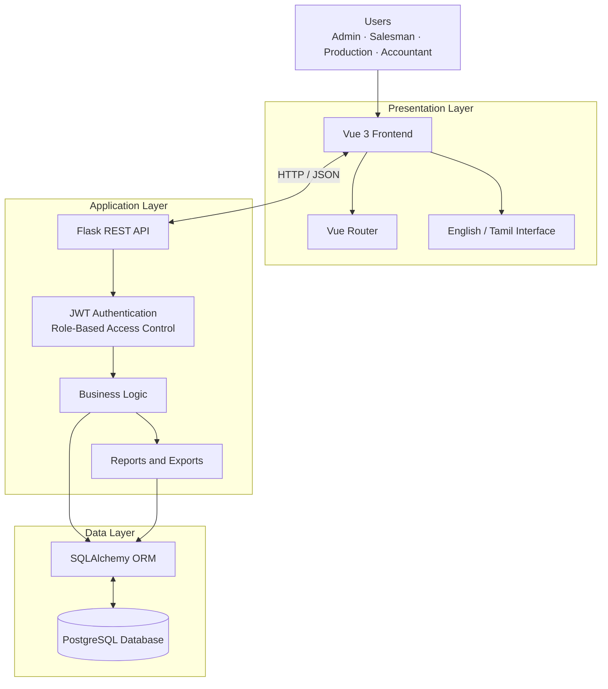
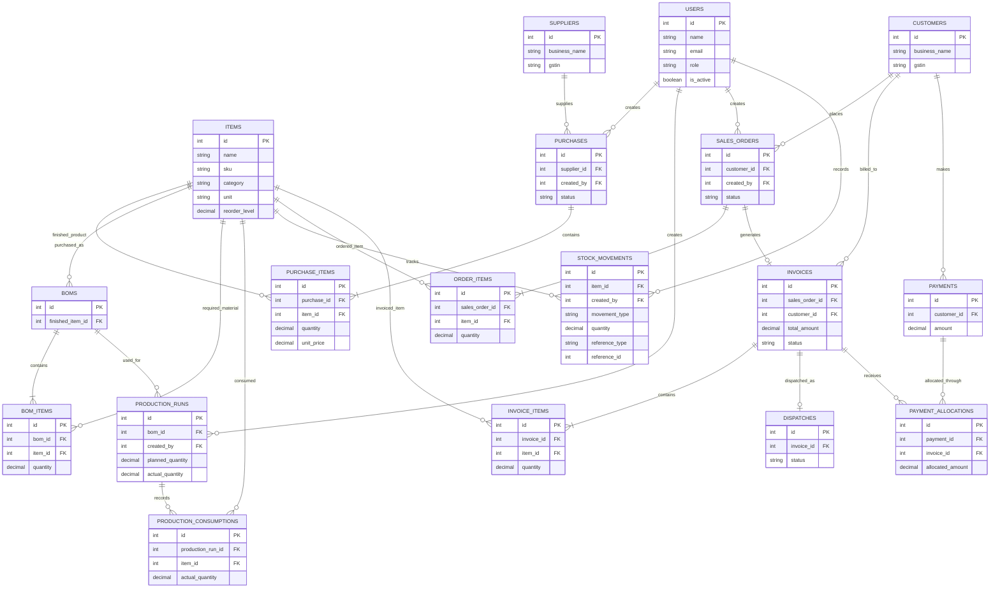
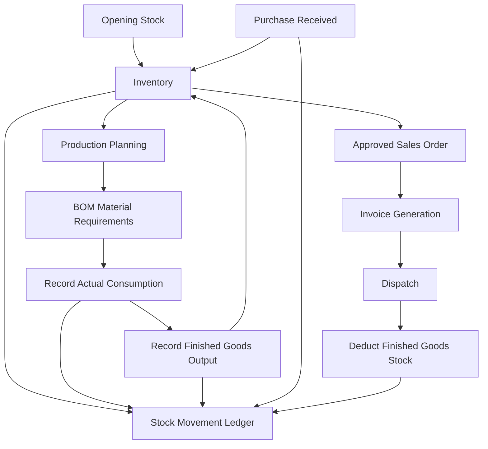

# SnackFlow ERP – Technical Design Note

**Project:** SnackFlow ERP  
**Domain:** Small-Scale Packaged Snacks Manufacturing  
**Technology Stack:** Vue 3 · Python Flask · PostgreSQL  
**Deployment:** Render

---

## 1. System Architecture

SnackFlow ERP follows a three-tier architecture that separates the presentation layer, application logic, and persistent data storage.

- **Frontend:** Vue 3 provides a responsive, bilingual (English and Tamil) interface. Vue Router manages navigation, and Axios communicates with backend REST APIs.
- **Backend:** Python Flask handles authentication, role-based authorization, business operations, inventory calculations, production workflows, invoicing, and reporting.
- **Database:** PostgreSQL stores users, master data, transactions, stock movements, and financial records. SQLAlchemy provides ORM-based database access, while Flask-Migrate manages schema migrations.
- **Deployment:** The frontend and backend are deployed as separate Render services, with PostgreSQL providing persistent storage.

### Architecture Diagram

---

## 2. Database Design

The database uses a relational model with primary keys and foreign-key relationships to maintain data consistency.

### Main Entities

| Entity                         | Responsibility                                         |
| ------------------------------ | ------------------------------------------------------ |
| Users                          | Employee accounts, roles, and account status           |
| Customers                      | Customer and GST information                           |
| Suppliers                      | Supplier information                                   |
| Items                          | Finished goods, raw materials, and packaging materials |
| BOMs / BOM Items               | Product recipes and material requirements              |
| Purchases / Purchase Items     | Purchase records and received materials                |
| Production Runs / Consumptions | Planned production, actual consumption, and output     |
| Stock Movements                | Inventory transaction history                          |
| Sales Orders / Order Items     | Customer orders and their products                     |
| Invoices / Invoice Items       | Invoice records and line items                         |
| Dispatches                     | Shipment and dispatch information                      |
| Payments / Payment Allocations | Customer payments and invoice settlements              |
| Audit Logs                     | Relevant system activity records                       |

### Entity Relationship Diagram

_Note: The diagram illustrates the principal business relationships. It is a logical overview rather than a complete representation of every database column._

---

## 3. Inventory and Production Workflow

SnackFlow maintains stock movement records to provide traceability for inventory changes.

### Inventory and Production Flow

### Stock Calculation

Inventory movements are recorded as stock-in or stock-out transactions.

**Current Stock = Opening Stock + Total Stock In − Total Stock Out**

Stock movements are recorded for:

- Opening inventory.
- Purchase receipts.
- Raw material consumption.
- Finished goods production.
- Dispatches.
- Inventory adjustments.

Each movement stores the item, movement type, quantity, source transaction reference, timestamp, and recording user where applicable.

The movement history supports traceability between inventory changes and their originating transactions.

### Production Variance

Bills of Materials (BOMs) define the planned quantities of materials required for a production run.

Actual material consumption and finished goods output are recorded separately.

**Material Variance = Actual Consumption − Planned Consumption**

**Yield Variance (%) = (Actual Output − Planned Output) / Planned Output × 100**

This allows production personnel and administrators to identify material overconsumption, underconsumption, and output differences.

---

## 4. Costing Methodology

The costing approach focuses on direct material consumption.

**Direct Material Cost = Σ (Actual Material Quantity × Applicable Unit Cost)**

**Material Cost per Good Unit = Total Direct Material Cost / Good Finished Units Produced**

Purchase records provide material quantity and unit-price information. The applicable material unit cost must follow the valuation method implemented in the application.

Labour, electricity, gas, and other overhead costs should be considered separately when estimating total manufacturing cost. The material-cost calculation alone is not a complete manufacturing cost or statutory inventory valuation.

---

## 5. Security and Design Assumptions

- JWT-based authentication protects application endpoints.
- Role-based access control distinguishes ADMIN, SALESMAN, PRODUCTION, and ACCOUNTANT users.
- Passwords are stored using secure password hashing.
- Customers and suppliers are business records, not application roles.
- The current deployment follows a single-tenant model, supporting one manufacturing organization per deployment.
- English is the default interface language; Tamil is available through the language selector. The selected preference is persisted in browser local storage.
- Business records and database values remain unchanged when switching interface languages.
- Inventory, production, sales, invoicing, dispatch, and payment operations are maintained as separate transactional workflows.

**Project Scope:** SnackFlow ERP connects procurement, inventory, manufacturing, sales, invoicing, dispatch, and payment management in a centralized system designed for a small-scale packaged snacks manufacturer.
